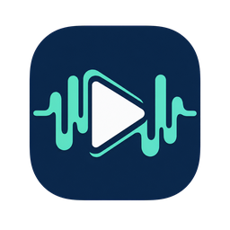

<p align="center">
  
</p>

<h1 align="center">Трансляції</h1>

<p align="center">Інтернет-радіо, live-відео та RTSP для Windows.</p>

<p align="center">
  <a href="https://serzhyale.github.io/StreamsPlayer/">Сайт</a> ·
  <a href="https://github.com/SerZhyAle/StreamsPlayer">Вихідний код</a> ·
  <a href="https://serzhyale.github.io/StreamsPlayer/privacy.html">Конфіденційність</a> ·
  <a href="https://serzhyale.github.io/FastMediaSorter_mob_v2/docs/media-exchange-portal/index-uk.html">Обмін медіа</a>
</p>

<p align="center">
  <strong>Мова:</strong>
  <a href="README.md">English</a> ·
  <a href="README.ru.md">Русский</a> ·
  <a href="README.uk.md">Українська</a>
</p>

> **Статус випуску:** «Трансляції» випущено, застосунок безкоштовний. Запустіть
> `StreamsPlayer-<version>-windows-x64-setup.exe` з
> [останнього релізу на GitHub](https://github.com/SerZhyAle/StreamsPlayer/releases/latest)
> - він встановлюється для поточного користувача й не потребує прав
> адміністратора - або встановіть з [Microsoft Store](https://apps.microsoft.com/detail/9NBTD5SXB8TB),
> завантажте портативний ZIP з того самого релізу чи встановіть командою
> `winget install SerZhyAle.StreamsPlayer`. Обліковий запис не потрібен, без реклами,
> без телеметрії; вихідний код під MIT.
>
> Інсталятор, ZIP і пакет winget не мають цифрового підпису, тому під час першого
> запуску Windows може показати **«Windows захистила ваш ПК»** -
> [що це за вікно і що натиснути](https://serzhyale.github.io/StreamsPlayer/uk/trust.html).
>
> Перед оновленням або видаленням закрийте STREAMS Player - якщо він відкритий,
> інсталятор попросить про це. Тихий запуск (`winget`, `/VERYSILENT`) не
> питає: він завершується з кодом 1 і нічого не змінює.

## Спокійний плеєр для потрібного вам потоку

| Знайдіть канал | Тримайте потрібне поруч | Відтворюйте потрібне медіа |
| --- | --- | --- |
| Переглядайте впорядкований каталог і фільтруйте за категорією, темою, мовою, країною чи типом медіа. | Шукайте, сортуйте, закріплюйте та додавайте власні потоки без обов’язкового облікового запису. | Слухайте радіо в головному вікні або відкривайте live-відео й RTSP в окремому вікні плеєра. |

«Трансляції» - незалежний desktop-застосунок для Windows, що працює з
інтернет-радіо, live-відео та RTSP-каналами. Він використовує опублікований банк потоків
FastMediaSorter як зовнішній контракт даних; код і можливості застосунку
FastMediaSorter до нього не переносяться.

## Можливості

- Верхня панель підлаштовується під ширину без зменшення тексту: коли місця мало, іконка фільтра відкриває пошук, швидкий відбір, фільтри та сортування під панеллю. «Налаштування» й «Операції» стають іконками з підказками. Пошук і значення фільтрів зберігаються. Під час мовлення з цього ПК червона іконка називає активні джерела в підказці мовою інтерфейсу.
- Оновлюйте каталог лише за вашою командою. Неочікуваних фонових завантажень
  каталогу немає.
- Спостерігайте за завантаженням каталогу та картинок прев’ю: обидва показують,
  скільки залишилося, і будь-яке можна зупинити будь-коли. Зупинене завантаження
  залишає ваш список каналів точно таким, яким він був.
- Заповнюйте список каналів без інтернету з копії каталогу, вбудованої в
  застосунок. Її пропонують один раз під час першого запуску з порожнім списком,
  пропонують знову, коли оновлення не проходить, і вона доступна будь-коли на
  на сторінці **«Бібліотека»** в **«Налаштуваннях»** (або через **«Налаштування бібліотеки»** в меню **«Операції»**). Копія лише додає й оновлює канали
  - і ніколи нічого не видаляє, - а застосунок завжди повідомляє, що список узято
  з вбудованої копії, і називає її дату, тож її неможливо сплутати зі свіжим
  завантаженням. Застосовувати її чи ні - завжди ваш вибір; саме нічого не
  відбувається.
- Читайте опублікований банк потоків із перевірками RFC-4180 CSV, порядку записів
  у ZIP та необов’язкового атласу favicon.
- Захищайте записи `MANUAL` і `IMPORTED` під час оновлення каталогу за URL.
- Зберігайте канал каталогу, з яким ви щось зробили, навіть після того, як
  каталог перестав його перелічувати. Рядок, якого ви не торкалися, так само
  видаляється, а рядок із закріпленням, членством у добірці, позначкою
  відтворення, записом в історії чи вибраним вами значком не видаляється, а
  виводиться з пропозиції: він зберігає свій ідентифікатор, тож закріплення,
  добірки й історія залишаються прив’язаними до нього. Виведений - означає
  збережений, але не пропонований: він зникає із загального списку каналів і з
  розіграшу **«Випадкової станції»**, бо канал, якого каталог більше не
  публікує, не має стояти серед актуальних так, ніби він досі доступний, - і
  залишається саме там, куди ви його поклали: у смузі закріплених каналів та
  всередині своїх добірок. Оновлення, у якому адреса з’явиться знову, просто
  поверне канал назад.
- Шукайте просто в рядку заголовка будь-коли, а рядок фільтрів і сортування
  відкривайте лише тоді, коли він потрібен, - кнопкою **«Фільтри та
  сортування»**. Рядок прихований під час першого запуску, запам’ятовує, чи ви
  залишили його відкритим, і закривається власною кнопкою, не чіпаючи ваших
  фільтрів; **«Очистити»** скидає фільтри, залишаючи рядок відкритим, а текст
  пошуку - недоторканим. Поки рядок прихований, кнопку позначено, а її підказка
  рахує фільтри, що досі звужують каталог. Фільтр мови мовлення спочатку показує
  вашу мову інтерфейсу та її регіональні варіанти й усе одно починається зі
  значення **«Усі»**.
- Перемикайтеся між «дивитися» і «слухати» просто в рядку заголовка: три
  маленькі кнопки поруч із **«Фільтри та сортування»** - це той самий фільтр
  медіа в одне натискання. Натисніть «відео» - лишиться тільки відео та RTSP,
  «аудіо» - тільки радіо, «свої» - тільки додані та імпортовані вами канали;
  повторне натискання тієї ж кнопки повертає весь список. Натиснута кнопка
  світиться, ненатиснута приглушена; у широкому вікні всі три лишаються на панелі незалежно
  від того, чи розкрито рядок фільтрів, звужують і закріплену смугу, і
  загальний список, і зберігаються до наступного запуску. Це той самий фільтр
  **«Медіа»**, що й у рядку, тож розійтися вони не можуть.
- Звужуйте список до однієї **теми** - це власний набір тем каталогу, від новин
  і класики до дорожніх камер. Назви тем показані мовою інтерфейсу й
  впорядковані за її абеткою, а сам каталог зберігає початкову англійську назву,
  тож список, вивантажений однією мовою, читається так само іншою. Тему, якої ця
  версія ще не знає, застосунок показує так, як її написав каталог, а не ховає.
  «Загальне» охоплює приблизно половину каталогу, тому стоїть у кінці списку,
  під темами, які справді його звужують.
- Приховуйте канали для дорослих із каталогу, фільтрів і «Випадкової станції» у
  будь-який час за допомогою параметра **«Приховувати канали для дорослих»** у
  налаштуваннях.
- Відкривайте рідковживані дії з одного меню **«Операції»** у верхній панелі:
  поверх усіх вікон, оновити прев’ю (у режимі сітки), **«Випадкова станція»**,
  історія, додати потік, **«Вставити канал»**, **«Налаштування бібліотеки»** і, окремо в
  кінці, **«Імпортувати канали з інтернету»**.
- Незалежно тримайте головне вікно або відеопрогравач поверх усіх вікон і
  розгортайте відео без системної рамки кнопкою, `F` чи `F11` (`Esc` - вихід).
  У відеоплеєрі `M` вимикає й вмикає звук, `Ctrl+Up` і `Ctrl+Down` змінюють
  гучність, а `A` відкриває меню аудіодоріжок, якщо в потоці їх більше однієї. У
  меню дій програвача з трьома крапками є його перемикач «Завжди зверху»,
  закріплення потоку та додавання його до наявної або нової колекції. У
  звичайному й повноекранному режимі панель керування програвача ховається
  через чотири секунди без дій; клацніть відео, щоб повернути її, не перериваючи
  відтворення, або натисніть на панелі кнопку-шпильку, щоб вона лишалася на
  екрані, - закріплення діє в усіх вікнах програвача й запам’ятовується. Програвач - самостійне вікно верхнього рівня: згортання й
  розгортання каталогу більше не забирає картинку із собою, а вихід із каталогу
  так само закриває всі програвачі.
- Перемикайтеся між списком і візуальною сіткою, яка зберігається між запусками,
  двома кнопками з іконками у верхній панелі. Підказки називають режим, а активний режим
  підсвічується. У сітці захоплюються видимі HTTP(S)-відеопрев’ю, до чотирьох
  одночасно, а кадри кешуються на диску в межах 150 МБ.
- Упізнавайте канал, якому каталог не дав значка, замість того щоб сприймати
  його як картинку, що не завантажилася. Значка немає в більшості опублікованих
  рядків, і порожній квадрат на його місці мав вигляд зображення, яке так і не
  прийшло. Тепер такий канал показує заглушку, побудовану з його власних даних:
  ініціали з назви та колір тла, виведений із тієї самої назви, тож та сама
  станція має однаковий вигляд за кожного запуску й на будь-якій машині; а якщо
  рядок несе країну, заглушка додає її дволітерний код. Вона з’являється і в
  списку, і в плитці сітки, у світлій і темній темі; там, де є захоплений кадр
  прев’ю, ви й далі бачите кадр.
- Відкривайте «Налаштування» шестернею в заголовку (або пунктом **«Налаштування бібліотеки»** в меню
  **«Операції»**), де зібрано параметри й обслуговування. Вісім сторінок перелічено збоку вікна, у кожної
  свій кольоровий значок; поточна сторінка має акцентну смугу, а її заголовок і короткий опис стоять над
  вмістом. Пов’язані параметри зібрано в іменовані групи, які згортаються по одній або всі разом двома
  кнопками поруч із полем пошуку. Кожен параметр має назву й коротку підказку, а поруч - свій елемент
  керування; прапорець стоїть поруч зі своїм підписом. Введіть текст у **«Пошук у налаштуваннях»**, щоб
  знайти параметр за назвою чи підказкою: кожен результат називає свою сторінку й групу, а вибір
  результату - клацанням або клавішами `Down` і `Enter` - відкриває сторінку, розгортає групу й ставить
  курсор на параметр. Сторінки:
  - **«Основні»**: мова інтерфейсу (**«Мова»**, позначена глобусом; 13 мов, лише самоназви), колірна
    тема (**«Слідувати системним налаштуванням»**, **«Світла»**, **«Темна»**), розмір плиток потоків
    (**«Дуже малий»**, **«Малий»**, **«Середній»**, **«Великий»**) і анімований фон;
  - **«Бібліотека»**: приховування каналів для дорослих, автоматичне оновлення прев’ю, імпорт архіву
    каталогу, вбудований список каналів, підтверджуване видалення завантаженого чи імпортованого
    каталогу, імпорт і експорт плейлистів M3U, приховані канали й телепрограма;
  - **«Відтворення»**: не давати комп’ютеру засинати, системні елементи керування медіа, відновлення
    відтворення під час запуску, вибір рушія (**VLC** або експериментальний **FlyleafLib**),
    встановлення й видалення компонентів FlyleafLib;
  - **«Звук»**: вибір пристрою виведення звуку й режиму каналів (стерео, обернене стерео, лівий,
    правий або Dolby Surround);
  - **«Файли»**: теки для збережених кадрів, відеозаписів і радіозаписів, з кнопками огляду, скидання
    й відкриття теки;
  - **«Сервер обміну»**: підключення облікового запису, керування входом і перевірка з’єднання;
  - **«Мовлення»**: дозвіл мовлення з цього ПК, вибір джерел, доступу через мережу та якості звуку;
  - **«Про програму»**: відомості про застосунок, версія `YY.MMDD.HHmm`, ліцензія MIT, посилання на
    інструкцію, проєкт, сайт, політику конфіденційності й сторінку автора, а також діагностичний пакет
    кнопкою **«Надіслати журнали авторові»**.
  На сторінках «Сервер обміну» та «Мовлення» елементи показано відразу, без груп, які можна згорнути.
  Усі оборотні параметри діють одразу після зміни, а закриття вікна (або `Esc`; у полі пошуку перший
  `Esc` очищає пошук) - єдиний вихід. Дії, що щось видаляють, спершу питають. «Налаштування»
  відкриваються на тій сторінці, де ви зупинилися, з тими самими розгорнутими групами, прокручені туди
  ж, і з тим розміром і положенням вікна, які ви задали.
- Зберігайте кадр, який дивитеся, кнопкою камери в плеєрі («Зберегти кадр»):
  файл JPEG з іменем `video_frame_YYMMDD_HHmmss_<канал>` потрапляє до теки кадрів, заданої
  на сторінці **«Файли»**, або до теки Frames у «Зображеннях», якщо її не вказано, і той
  самий кадр стає значком каналу. Другий кадр у ту саму секунду отримує ` (2)`; якщо до теки
  не можна записати, файл іде до наступної - типової, потім «Завантажень», - і повідомлення
  називає, куди.
- Записуйте прямий ефір кнопкою «Запис» (або клавішею `R` у відеоплеєрі):
  зберігає поточний відео- або радіопотік безпосередньо у медіафайл без перекодування
  та без переривання відтворення, а після завершення повідомляє ім'я збереженого файлу.
  Відеозапис має ім'я `stream_video_YYMMDD_HHmmss_<канал>` і потрапляє до теки Recordings у
  «Відео», радіозапис `stream_audio_..` - до теки Recordings у «Музиці», якщо на сторінці
  **«Файли»** не вибрано інших тек. Запис відео переживає перепідключення -
  кожне підключення зберігається окремим файлом, і наприкінці повідомляється про всі; запис
  радіо отримує розширення за форматом, який станція справді передає, і за посиланням
  `.pls`/`.m3u` записує сам потік, а якщо станція обриває з'єднання, одразу повідомляється,
  що збережено і якої тривалості. У власному вікні вхідної аудіотрансляції кнопка запису або `R`
  записує вже наявне з'єднання, зберігаючи одного слухача. Зупинка відтворення, перепідключення
  або закриття вікна зберігають поточний запис; після перепідключення почніть запис знову.
  Звук зберігається в отримуваному форматі без перекодування:
  MP3, AAC, Ogg, Opus, FLAC або WAV. Вихід під час запису безпечний:
  застосунок чекає, поки файл потрапить до теки записів, а все, чого дочекатися не вдалося,
  потрапляє туди за наступного запуску - з повідомленням про це.
- Вирішуйте, що робити з невдалим потоком, у діалозі помилки - **«Повторити»**,
  **«Копіювати звіт»**, **«Залишити»** або вилучення: канал каталогу
  приховується, а ваш власний канал видаляється після підтвердження. Приховані
  канали каталогу переживають оновлення й повертаються через **«Приховані»** на
  сторінці **«Бібліотека»** в **«Налаштуваннях»**.
- Додавайте потік вручну та зберігайте локальні позначки результату відтворення.
- Відкрийте «Про канал» з меню каналу з трьома крапками або з меню дій програвача,
  щоб побачити на одній сторінці все, що відомо про канал: чим він є і звідки
  з'явився, що про нього повідомляє каталог і що насправді передає його потік -
  формат відео та звуку, розмір зображення, частоту кадрів, звукові канали, частоту
  дискретизації та виміряну швидкість. Під час відкриття вікно один раз під'єднується
  до потоку, щоб виміряти його; якщо канал уже грає, програвач знає відповідь і
  нічого не відкривається. «Копіювати все» кладе весь список у буфер обміну.
- Повертайтеся до каналу з приватної історії **«Нещодавно відтворені»** - це
  останні 100 каналів, які ви відтворювали, з останнім поміченим текстом про
  поточний трек, якщо станція його передає. Історія зберігається лише локально,
  ніколи не вивантажується та очищується на вимогу; вилучений канал залишається
  у ній як невідтворюваний запис.
- Дивіться, що йде на телеканалі зараз і що буде далі, за обраною вами
  телепрограмою: вставте адресу програми XMLTV (`.xml` або `.xml.gz`, наприклад
  із проєкту iptv-org/epg) у розділі **«Телепрограма»** на сторінці **«Бібліотека»** в **«Налаштуваннях»** і
  натисніть **«Завантажити програму»**. Після цього під кожним зіставленим
  каналом у списку видно поточну передачу, а програвач показує поточну й
  наступну передачі з часом - за вашим місцевим часом. Канали зіставляються за
  точною назвою; назва, яку програма використовує для кількох каналів, не
  зіставляється з жодним, а пункт **«Канал телепрограми..»** у меню каналу
  дозволяє прив’язати його вручну або вимкнути для нього програму. Програма
  завантажується лише після натискання кнопки, зберігається на 36 годин уперед у
  межах фіксованого обсягу, ніколи не оновлюється у фоні, а **«Видалити
  програму»** видаляє її. Канал без програми виглядає і грає точно так само, як
  раніше.
- Імпортуйте канали з локального файлу `.m3u`/`.m3u8` або за HTTP(S)-посиланням
  на плейлист - вони додаються як записи `IMPORTED` після попереднього перегляду
  з кількістю нових, повторюваних, недопустимих і пропущених записів, який
  застосовується однією неподільною дією; медіаманіфести HLS не імпортують нічого
  й пояснюють чому. Імпорт обмежено 100 000 новими каналами. Попередній перегляд
  попереджає, якщо прочитано лише початкову частину; розділіть плейлист для
  імпорту решти каналів.
- Експортуйте додані вами канали (`MANUAL`/`IMPORTED`) або лише закріплені з них
  у файл M3U в кодуванні UTF-8 - із попередженням перед записом будь-якої
  адреси, що містить облікові дані.
- Рекомендуйте один канал звичайним повідомленням у чаті: **«Копіювати текст для
  надсилання»** в меню дій каналу кладе до буфера обміну один короткий рядок на
  зразок `SPCH1 https://example.test/live`, який ви вставляєте в Telegram чи будь-де
  ще. Отримувач обирає **«Вставити канал»** - у меню операцій або на панелі
  порожнього каталогу під час першого запуску, - бачить, що знайдено, і підтверджує,
  перш ніж щось буде додано записом `IMPORTED`. Рядок несе лише адресу: назва
  виводиться з адреси, тож пароль чи токен усередині адреси побачить кожен, хто
  отримає ваше повідомлення, і копіювання такого каналу спершу запитає
  підтвердження. Наявний канал не додається вдруге - застосунок відкриває його у
  списку та пропонує показати знову, якщо ви його приховали.
- Слухайте пряму аудіотрансляцію з телефона чи годинника з FastMediaSorter.
  Імпортувати її можна трьома способами: вставити текст її штрихкоду
  (`FMSBCAST1:` ..) або посилання «Поділитися» з Android через **«Вставити
  канал»** - сам штрихкод сканує будь-який застосунок-сканер, у StreamsPlayer
  немає камери, і він бере лише розшифрований текст; відкрити файл `.fmsbcast` у
  діалозі імпорту плейлиста в «Налаштуваннях» («Бібліотека»);
  або перетягнути один файл `.fmsbcast` на головне вікно. Застосунок показує назву
  й адресу та запитує, перш ніж додати; файли понад 64 КіБ відхиляються.
  Трансляція стає записом `IMPORTED` з позначкою **«Прямий ефір»**, а повторний
  імпорт з того самого пристрою оновлює цей запис - адресу, порт, назву - замість
  дубліката, тож закріплення, добірки й історія зберігаються; оновлення каталогу
  її ніколи не видаляє. Грають і аудіо-, і камерні трансляції. В описі може бути
  перелічено кілька способів дістатися однієї й тієї самої трансляції, і застосунок
  пробує їх у тому порядку, який задав пристрій, під час повторного під'єднання
  починаючи спочатку: спочатку адресу в локальній мережі; потім, якщо він указаний,
  роздача потоку через сервер обміну з опису - потік по HTTPS, чей самопідписаний
  сертифікат звіряється з відбитком з опису (через тимчасовий локальний проксі на
  127.0.0.1, коли рушій плеєра не може звірити відбиток сам; перевірка ніколи не
  вимикається); потім з’єднання через сервер. Відео потрапляє у вікно плеєра через RTSP або, у
  локальній мережі, у вигляді MPEG-TS; аудіо йде власним з'єднанням із малою
  затримкою. Відтворення йде окремим шляхом із
  малою затримкою: звук приблизно за секунду й відставання від пристрою не більше
  двох секунд; після обриву застосунок перепід'єднується обмежену кількість разів
  і повертається до живого моменту, а не програє пропущене. Годинник допускає лише
  чотирьох слухачів, тож застосунок відкриває рівно одне під'єднання за сеанс
  прослуховування й ніколи не перевіряє адресу заздалегідь - вікно «Про канал» її
  теж не вимірює. Якщо в годинника вже чотири слухачі, застосунок так і повідомляє,
  без повторних спроб; якщо пристрій перестав транслювати, після обмеженої
  кількості спроб він повідомляє, що трансляцію припинено або пристрій недоступний,
  замість нескінченного «Підключення». Тихий мікрофон застосунок не підсилює:
  гучність така, яку передає пристрій.
- Дізнайтеся, як ваші пристрої обмінюються медіа і яка програма що робить на
  кожному з них - телефоні, годиннику, телевізорі, VR-гарнітурі та ПК з Windows, -
  у [порталі обміну медіа](https://serzhyale.github.io/FastMediaSorter_mob_v2/docs/media-exchange-portal/index-uk.html).
  «Трансляції» - його програвач прямих трансляцій для Windows; на
  [сторінці про прямий ефір](https://serzhyale.github.io/FastMediaSorter_mob_v2/docs/media-exchange-portal/live-broadcast-uk.html)
  сказано, хто може вийти в ефір, як трансляція доходить до слухача і що
  працює вже сьогодні. Те саме посилання є на сторінці «Про програму» в
  «Налаштуваннях».
- Якщо сервер обміну не підключається, натисніть **«Перевірити з'єднання»** на сторінці **«Сервер обміну»** в **«Налаштуваннях»**, у списку трансляцій або у вікні трансляції, яка перервалася. Перевірка запускається лише за вашим натисканням: вона йде по одному кроку від цього комп'ютера до сервера, зупиняється на першому кроці, що не пройшов, і тими самими словами, що й інші програми родини, каже, що сталося і що спробувати. Адресу й порт сервера видно лише в **«Подробицях»**, а в журналі лишається один рядок із кодами - без адреси, логіну й пароля.
- Трансляції, що йдуть через сервер обміну, захищені від краю до краю: те, що надсилає цей комп'ютер, шифрується тут і відкривається лише на пристроях вашого акаунта або в того, хто тримає видане вами посилання, а те, що він приймає, відкривається тут. Трансляція, чиї адреси через сервер не захищені (стара програма або пристрій без ключа), через сервер не відтворюється - у тій самій мережі вона, як і раніше, грає, - і список трансляцій або вікно каже про це. Пристрій, що увійшов до появи захисту, продовжує працювати, але не бере участі, доки ви не видалите сервер зі списку й не додасте його знову. Сервер обміну з'єднує ваші пристрої, тому знає імена вашого акаунта, пристроїв, папок і трансляцій, бачить, які пристрої в мережі, і скільки й коли передається. Відкрити те, що йде через нього, він не може: папки та їхні файли, трансляції й буфер шифруються на вашому пристрої та відкриваються лише на інших ваших пристроях або в тих, кому ви дали доступ. Щоб зазирнути всередину, тому, хто керує сервером, довелося б додати до вашого акаунта свій пристрій, і він з'явився б у списку ваших пристроїв.
- Видаляйте завантажені або імпортовані потоки каталогу однією підтвердженою
  дією на сторінці **«Бібліотека»** в **«Налаштуваннях»**. Ваші додані канали,
  закріплені канали, канали в колекціях і канали з історією прослуховування
  зберігаються. **«Імпортувати канали з інтернету»** завантажить видалений каталог знову.
- Перемикайте весь інтерфейс між тринадцятьма мовами вибором мови на сторінці **«Основні»** в
  «Налаштуваннях» (позначено глобусом) - включно з розкладкою справа
  наліво для арабської та урду; вибір відновлюється під час наступного запуску, а
  перший запуск успадковує мову Windows.
- На сторінці **«Основні»** в «Налаштуваннях» виберіть, чи інтерфейс наслідує колірну
  тему Windows, завжди світлий або завжди темний; типово інтерфейс наслідує
  Windows, явний вибір відновлюється під час наступного запуску, а системний
  вибір змінюється в тому самому сеансі зі зміною теми Windows.
- Об’єднуйте канали в локальні іменовані добірки, відкривайте одну добірку через
  фільтри каталогу та керуйте ними, не зачіпаючи закріплення й каталог.
- Зупиняйте звук, не втрачаючи станцію: кнопка аудіо в нижній панелі стала
  перемикачем відтворення, тож «Зупинити аудіо» обриває сеанс, але лишає станцію
  поточною і перетворюється на «Відновити аудіо», яке вмикає її знову з живого
  краю. Гучність і таймер сну лишаються на панелі, а не зникають разом із
  кнопкою, і пауза із системного медіафлаута Windows приводить панель точно до
  того самого стану. Справжня зупинка - натискання на станцію, що грає, у списку,
  «Стоп» із флаута або запуск іншої станції - так само очищає станцію разом з
  елементами керування.
- Вмикайте таймер сну для радіо - 15/30/45/60 хвилин або час за годинником - зі
  зворотним відліком поруч із кнопкою «Зупинити аудіо»; він переживає зміну
  станції та один раз зупиняє відтворення після завершення.
- Довірте вибір каталогу: **«Випадкова станція»** в меню **«Операції»** бере одну
  радіостанцію з усього каталогу і вмикає її. На жереб не впливають поточний
  пошук, відкриті фасети та активна добірка, а приховані вами канали, канали для
  дорослих, поки їх приховано, відео й адреси RTSP не випадають ніколи. Станція, що відмовила або, з’єднавшись, мовчить
  десять секунд, поступається місцем наступному кидку - без діалогу, який треба
  закривати; після п’яти таких станцій поспіль перебір зупиняється сам і каже про
  це в рядку стану. Список при цьому не рухається - ні прокрутка, ні фільтри, - а
  повторне натискання починає перебір заново, а не запускає другий поруч. Станція,
  що заграла, поводиться як будь-яка інша: історія, системний медіафлаут Windows,
  таймер сну та відновлення під час наступного запуску працюють як завжди. Та сама
  команда є на компактній панелі радіо нижче.
- Станція, що грає, має спокійний анімований фон - пливучі лінії та частинки, той
  самий рух, що в аудіоплеєрі FastMediaSorter: на її картці у списку, на плитці в
  сітці (зображення станції переходить на плашку по центру) і в компактній панелі
  радіо нижче. Фон приглушений, щоб текст читався, слідує світлій і темній темі,
  завмирає на останньому кадрі після зупинки, нічого не малює, поки його не
  видно, і зупиняється в режимі енергозбереження Windows. Вимикається в
  **Налаштуваннях** пунктом **Анімований фон у станції, що грає**.
- Згортайте каталог у компактну панель радіо, поки грає станція. Кнопка поруч із
  кнопкою відтворення ховає каталог і лишає маленьку смужку без системного
  заголовка: верхній рядок називає станцію й поточний трек, а нижній несе
  гучність, таймер сну з відліком, попередню й наступну станцію, «Випадкову
  станцію», «Запис», зупинку й відновлення та власні кнопки панелі - поверх усіх
  вікон (увімкнено, доки ви не вимкнете), повернення до повного вікна, згорнути
  й закрити. Перетягується за будь-яке вільне місце. Два види - один застосунок: один пункт у панелі
  задач, одне перемикання за Alt+Tab, один звук, і все, що змінюється в одному
  вигляді, видно в іншому. Зупинка радіо лишає панель на місці, а не викидає
  каталог поверх вашої роботи; так само поводиться й станція, що обірвалася.
  Перетягуйте її куди завгодно: панель, зсунута за край екрана або лишена на
  моніторі, який потім вимкнули, повертається на видимий екран.
  Розгортання повертає повне вікно точно таким, яким ви його лишили, разом із
  прокруткою, фільтром і виділенням. Панель - режим на час сеансу: наступний
  запуск завжди відкриває каталог.
- Зберігайте стан каталогу, ручні записи, закріплення, добірки, приховані канали каталогу, історію прослуховування, кешовані кадри прев’ю та діагностичні журнали десяти останніх запусків у
  `%LOCALAPPDATA%\StreamsPlayer` - `Current.log` для поточного сеансу та
  `Session-<дата>-<час>.log` для дев’яти попередніх.
- Повідомляйте про проблему кнопкою **«Надіслати журнали авторові»** на сторінці **«Про програму»** в **«Налаштуваннях»**: програма запакує ці діагностичні журнали
  разом із короткою зведенням про версію програми, версію Windows і налаштування в
  один архів у **теці кадрів**, якщо її вибрано на сторінці «Файли», інакше в
  «Завантаженнях», а потім відкриє вашу поштову програму з уже готовим
  листом. Підтвердження покаже повний шлях і за вашим запитом відкриє цю теку.
  Автоматично нічого не надсилається - архів ви прикріпите й натиснете «Надіслати»
  самі. У журналах указані потоки, які відтворювалися, тому надсилайте їх лише якщо
  готові цим поділитися.

Радіо відтворюється вбудованим LibVLC в окремому рушії лише для звуку, а
трансляція FastMediaSorter іде власним шляхом із малою затримкою; для відео й
RTSP теж використовується LibVLC, з 15-секундним буфером прямого ефіру - 4 секунди, коли
зупинений потік відкривається повторно, - та видимим ходом буферизації. Для
кадрів сітки також використовується LibVLC. Відтворення прямого ефіру
відновлюється після тимчасових мережевих збоїв і беззвучних зупинок - зокрема
потоку, який перестав надсилати дані, і далі повідомляючи, що грає: таке
зависання розпізнається, і потік відкривається наново, замість того щоб лишити
завмерлу картинку, - за обмеженою політикою повторів: показується окремий стан
повторного підключення, а коли спроби вичерпано - описаний вище діалог помилки.
Поки картинки немає, програвач просто поверх відео пише причину - підключення,
втрата сигналу, повторне підключення з номером спроби або зміна якості, - і цей
напис розміщено так, що він лишається видимим після автоприховування панелі
керування. За HLS-потоком, який пропонує кілька якостей, застосунок стежить під
час відтворення: повторне спустошення буфера опускає стелю на одну сходинку,
програвач пробує піднятися назад, коли з'єднання це дозволяє, а стеля, на якій
він зупинився, запам'ятовується для кожного каналу, тож наступний сеанс
відкривається одразу на ній, а не вимірює наново. Станція, яка публікує
ICY-метадані, показує поточний трек поруч із назвою станції, у вікні програвача
під назвою каналу та в **«Нещодавно відтворені»**, а також у медіасеансі
Windows, коли увімкнено системні елементи керування медіа. У відеоплеєрі можна
вибрати аудіодоріжку та субтитри, якщо потік містить більше ніж одну доріжку.

Відео та RTSP можуть працювати і на другому, експериментальному рушії FlyleafLib -
його вибирають у **«Налаштування → Відтворення»** як запасний варіант для потоку,
який погано поводиться у VLC. Йому потрібні бібліотеки FFmpeg, що не входять до
складу програми; на цій сторінці видно, чи встановлені вони, і тут же їх можна
завантажити.
Типовим лишається VLC, доки ви не зміните рушій самі.


## .spres

У 64-бітному переглядачі натисніть правою кнопкою на відео, аудіофайл або його теку й виберіть трансляцію. Менеджер спільного доступу видає файл .spres, QR-код або швидке посилання для імпорту в StreamsPlayer. Тека стає одним каналом із зафіксованим списком: оновлення замінює список, відкликання вимикає посилання. HTTP-шлюз має окремий перемикач і типово вимкнений. Токен надає доступ лише для читання однієї трансляції, зазвичай на 24 години. HTTP не шифрується: передавайте документ особисто й вмикайте інтернет-доступ лише за потреби.

## Елементи керування

Той самий значок і та сама назва в усіх продуктах портфеля - у застосунку, на сайті й тут (спільний словник `ICON-SET`).

| | Елемент |
| --- | --- |
|   | **Відтворити** / **Зупинити** - рядок каналу, смуга радіо, компактна панель; жива кнопка показує, що зробить натискання |
|   | **Попередня станція** / **Наступна станція** - компактна панель |
|  | **Випадкова станція** - меню **Операції** та компактна панель |
|  | **Запис** - смуга радіо, компактна панель, відеоплеєр (`R`) |
|  | **Таймер сну** - поруч із **Зупинити аудіо** |
|  | Компактна панель - смуга радіо; панель має власну кнопку повернення до повного вікна |
|   | **На весь екран** / **Вийти з повноекранного режиму** - відеоплеєр (`F` або `F11`) |
|   | **Вимкнути звук** / **Увімкнути звук** - відеоплеєр (`M`; `Ctrl+Up` і `Ctrl+Down` змінюють гучність) |
|  | **Інші дії** - меню каналу; меню **Операції** в заголовку |
|  | **Налаштування** |
|  | **Довідка** (`F1`) - у вікна з довідкою ця кнопка стоїть біля правого верхнього кута; вона відкриває сторінку цього вікна в браузері, інтернет не потрібен. Сторінки написані англійською, російською та українською; в інших мовах інтерфейсу відкривається англійська сторінка |
|   | **Фільтри та сортування** / **Очистити** фільтри |
|   | Каталог списком / плиткою |
|  | **Закріпити** канал угорі списку |
|  | **Імпортувати канали з інтернету** - завантажити спільний каталог знову |
|   | Імпорт / експорт плейлиста - **Налаштування (Бібліотека)** |

## Запуск із вихідного коду

```powershell
./build.ps1 -Test -Deploy:$false
./run.ps1
```

`build.ps1` типово виконує деплой: без `-Deploy:$false` він примусово збирає Release і копіює готовий
виконуваний файл до локальних тек автора. `run.ps1` цього не робить ніколи.

Або запустіть desktop-застосунок безпосередньо:

```powershell
dotnet run --project src/StreamsPlayer.App
```

## Запуск потоку

Пряму адресу можна відкрити без завантаження каталогу:

```powershell
StreamsPlayer.exe --url "https://example.test/live"
```

Для збереженого каналу відкрийте його меню  з трьох крапок і скористайтеся
**«Копіювати команду запуску PowerShell»** або **«Створити ярлик на робочому столі»**. Скопійовану команду вставляйте в PowerShell.
Ці варіанти передають постійний GUID каналу і, коли це безпечно, його адресу, тож канал
знаходиться й після того, як оновлення каталогу видало йому новий GUID:

```powershell
StreamsPlayer.exe --id "GUID-каналу" --url "https://example.test/live"
```

Якщо адреса містить облікові дані або її не можна безпечно додати до команди запуску,
ярлик чи скопійована команда передає лише GUID. Програма повідомить про це.
Такий запис працює, лише доки канал є у вашій бібліотеці; адреса не потрапляє
до ярлика чи командного рядка.
Ярлики, створені в попередніх версіях, слід створити заново, щоб видалити вже збережену адресу.

Звичайний запуск без аргументів нічого не вмикає. Увімкніть **Відновлювати
відтворення під час запуску** на сторінці «Відтворення» в налаштуваннях - і запуск
поверне те, що грало в момент останнього закриття: і радіостанцію, і кожне вікно
плеера. Типово вимкнено.

## Розробка

| Область | Призначення |
| --- | --- |
| `src/StreamsPlayer.Core` | Незалежні від платформи контракти каталогу, розбір, злиття та локальне зберігання. |
| `src/StreamsPlayer.App` | WPF-застосунок для Windows. |
| `tests/StreamsPlayer.Core.Tests` | Модульні та контрактні тести. |
| `tools/StreamsPlayer.CatalogHarness` | Діагностична утиліта для live-банку потоків. |
| `docs/` | Сайт GitHub Pages і документація для супровідників. |

Запустіть локальну перевірку у release-стилі:

```powershell
./scripts/check.ps1
```

Запуск перевірки live-банку:

```powershell
dotnet run --project tools/StreamsPlayer.CatalogHarness -- artifacts/favicon-sample.png
```

`build.ps1` - локальна збірка Windows-застосунку: вона створює self-contained EXE
і розміщує його в локальних каталогах застосунків. Скрипт не створює коміт, push,
тег або публікацію випуску. Для звичайної збірки рішення без розміщення використовуйте
`-Deploy:$false`.

## Конфіденційність

Застосунок «Трансляції» не потребує облікового запису для звичайного використання й не містить реклами, аналітики,
телеметрії чи сервісу, яким керує автор. Необов’язковий обліковий запис обміну належить закритому серверу - вашому власному або тому, чий власник вас запросив, - але ніколи сервісу цього продукту. Мережа використовується лише за вашою
дією: коли ви імпортуєте публічний каталог або погоджуєтеся на запропонований
після цього необов’язковий пакет прев’ю (обидва - з GitHub); коли ви
відтворюєте чи записуєте потік, відкриваєте для нього **«Про канал»** або
тримаєте активним режим сітки, доки оновлюються видимі відеопрев’ю (усе це - до
постачальника самого потоку); коли ви слухаєте імпортовану трансляцію
FastMediaSorter (до цього пристрою у вашій локальній мережі, а - коли він указаний
в описі й адреса локальної мережі недосяжна - через ваш сервер обміну
по TLS, з локальною передачею через проксі на 127.0.0.1, поки вона грає); і коли ви
завантажуєте необов’язкові бібліотеки FFmpeg в **«Налаштуваннях» («Відтворення»)** (зі
стороннього проєкту на GitHub, `BtbN/FFmpeg-Builds`); і коли ви натискаєте
**«Завантажити програму»** в **«Налаштуваннях» («Бібліотека»)** (за адресою телепрограми, яку ви
ввели самі). Локальні дані покидають ваш пристрій лише якщо ви надішлете їх самі:
**«Надіслати журнали авторові»** готує архів і лист у вашій власній поштовій
програмі та ніколи нічого не надсилає самостійно. Докладніше - на
[сторінці конфіденційності](https://serzhyale.github.io/StreamsPlayer/privacy.html).

Необов’язкове джерело обміну в налаштуваннях сервера обміну підключається до вашого сервера через TLS. Під час входу надсилаються ваш логін, пароль або код сполучення, ідентифікатор пристрою, версія продукту та можливості приймача; ця програма лише входить в обліковий запис і ніколи його не створює. Подальші підключення використовують ідентифікатор пристрою та токен пристрою. Поки джерело ввімкнено, зберігається одне з’єднання з перевірками активності та повторним підключенням; вимкнення закриває його. Імпортуйте рядок підключення, файл або QR-картинку в налаштуваннях бібліотеки чи вставте або перетягніть їх у головне вікно. Рядок містить адресу сервера й необов’язковий відбиток сертифіката, без секрету; запрошення всередині нього перевіряється й відкидається, ніколи не надсилається й не зберігається. Читання лише заповнює форму. Адреса й порт сервера містяться в розділі «Подробиці» форми: перевірте їх перед введенням пароля або коду сполучення; вони не зберігаються. Заданий відбиток має збігтися, без запиту довіри. Якщо його немає, ви підтверджуєте відбиток сервера перед входом; сертифікат, оновлений із тим самим ключем, приймається, а будь-яка інша зміна потребує вашого підтвердження. Зміна пароля облікового запису один раз надсилає старий і новий пароль вашому серверу й не зберігає жодного з них. Локальний агент чи друга програма не потрібні. Пароль і код сполучення не зберігаються. Обліковий запис, токени й відбитки сертифікатів захищені для вашого користувача Windows в окремих файлах; вихід на цьому пристрої забуває їх. Архів діагностики не містить цього файлу та приховує дані запису. З’єднання з обміном починається лише після вашого явного налаштування джерела.

Мовлення: програма може надсилати звук цього ПК - обраний вами мікрофон і звук, який відтворює ПК, - наживо на сервер обміну вашого облікового запису, і лише коли ви дозволите це в налаштуваннях і самі запустите джерело; до того все вимкнено, нічого не записується, доки вимкнено, а доки джерело в ефірі, показується помітний індикатор зі кнопкою зупинки. Слухачі підключаються локальною мережею, якщо ви її ввімкнули, або через сервер обміну. Кількість слухачів можна обмежити. Кожна окремо надіслана копія використовує вихідний трафік цього ПК; сервер обміну може роздати одну копію багатьом слухачам. Посилання або файл трансляції, які ви передаєте іншим, містять назву, адреси та ключі доступу до трансляції. Зберігайте їх як секрет і передавайте лише обраним людям. У каталозі облікового запису ключі містяться в зашифрованому пакеті.

**Сервер обміну, мовлення та шифрування.** Сервер обміну закритий: кожен запускає власний або користується тим, чий власник його запросив. Публічного сервера обміну немає, і жоден сервер обміну не є сервісом цього продукту. Сервер обміну з'єднує ваші пристрої, тому знає імена вашого акаунта, пристроїв, папок і трансляцій, бачить, які пристрої в мережі, і скільки й коли передається. Відкрити те, що йде через нього, він не може: папки та їхні файли, трансляції й буфер шифруються на вашому пристрої та відкриваються лише на інших ваших пристроях або в тих, кому ви дали доступ. Щоб зазирнути всередину, тому, хто керує сервером, довелося б додати до вашого акаунта свій пристрій, і він з'явився б у списку ваших пристроїв. Щоб увійти, цей комп’ютер один раз надсилає ваш логін і пароль або код сполучення, потім ідентифікатор пристрою, його назву (STREAMS Player, а не ім’я вашого комп’ютера), продукт, версію та платформу (Windows), ролі, можливості приймача та відкриту половину свого ключа шифрування. Поки з’єднання ввімкнено, сервер бачить, що цей пристрій у мережі. Коли ви ведете мовлення, він отримує назву трансляції, відомість про те, що це звук, і сам звук, зашифрований на цьому комп’ютері до надсилання; закритий ключ ніколи не залишає цей комп’ютер. Мовлення лишається вимкненим, доки ви не дозволите його в налаштуваннях, а кожне джерело ви запускаєте самі; лише якщо ви додатково ввімкнули запуск разом із програмою, залишені вибраними джерела знову запускаються під час старту програми, коли обліковий запис у мережі. Пристрій слухача може записувати те, що отримує, і ця програма не може цьому запобігти. Камера цього комп’ютера використовується лише для одного: щоб прочитати QR-код підключення, коли ви натискаєте «Сканувати камерою» в налаштуваннях. Поки відкрите вікно сканування, зображення розглядається лише в пам’яті, щоб знайти QR-код; воно ніколи не зберігається, не надсилається і не записується в журнал, а камера звільняється в момент закриття вікна. Якщо Windows не повідомляє про камеру, кнопку не показано. Ця програма входить в обліковий запис і ніколи його не створює. Обліковий запис видаляється у FastMediaSorter на телефоні або за проханням до того, хто керує сервером; як це зробити, пояснює [портал обміну](https://serzhyale.github.io/FastMediaSorter_mob_v2/docs/media-exchange-portal/account-deletion-uk.html). Вихід на цьому пристрої видаляє цей пристрій, а не обліковий запис. Те саме твердження всіма мовами сайту - на [сторінці конфіденційності](https://serzhyale.github.io/StreamsPlayer/privacy.html).

Трансляції інших користувачів не потребують облікового запису обміну. Адреса сервера й необов’язковий відбиток сертифіката беруться з опису; власний обліковий запис і його відбиток не використовуються. Трансляція, захищена власним паролем, просить цей пароль один раз, запам’ятовує його разом із каналом і надсилає його лише серверу цієї трансляції; змінений пароль запитується знову з одним повідомленням, і нічого не повторюється у фоні. Протягом дня можна підключатися до будь-якої кількості серверів. Одночасно відкриті щонайбільше 16 проксі та з’єднання через серверних перенаправлювачів; зупинка відтворення звільняє з’єднання, а простій закриває його через 30 секунд. Якщо відбитка немає, комп’ютер перевіряє сертифікат. Якщо перевірити його не вдалося, звірте показаний відбиток з автором трансляції перед підтвердженням для цього каналу. Інші канали цю довіру не успадковують.

## Авторство та ліцензія

Автор і власник «Трансляцій» -
[Сергій Жигуненко / SerZhyAle](https://github.com/SerZhyAle).

Ліцензія - [MIT](LICENSE).

На цьому пристрої зберігається один обліковий запис обміну. Зміна сервера або логіна потребує підтвердження видалення поточного запису; повторний вхід до того самого запису зберігає ідентифікатор пристрою. Під час видалення запису програма просить сервер видалити цей пристрій, потім забуває локальне підключення, навіть якщо сервер недоступний. Імпортовані канали зберігаються. Якщо сповістити сервер не вдалося, програма повідомляє, що пристрій може залишитися в списку, доки інший пристрій не видалить його; повторних спроб видалення у фоні немає.
